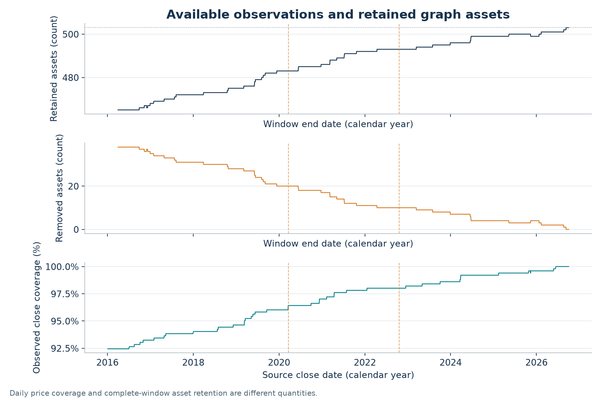
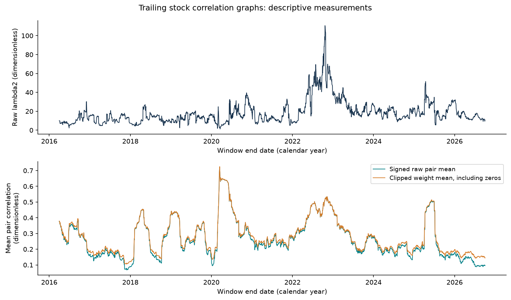
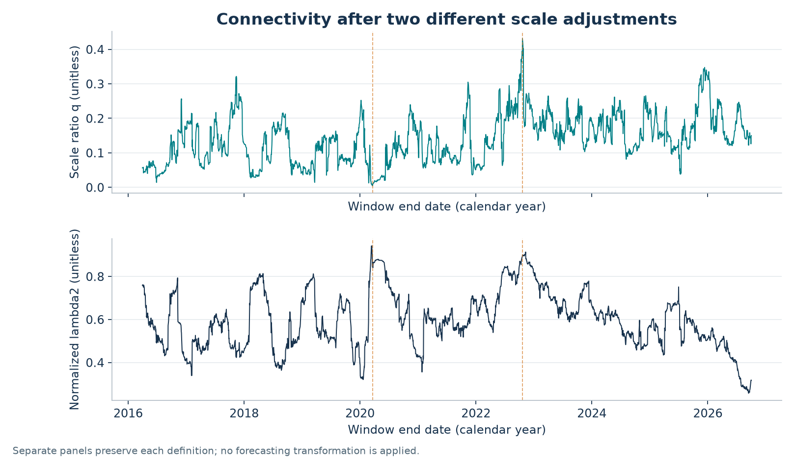
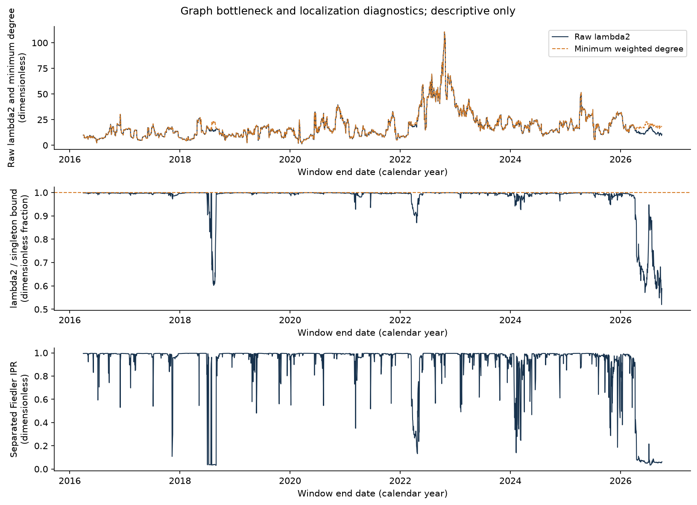
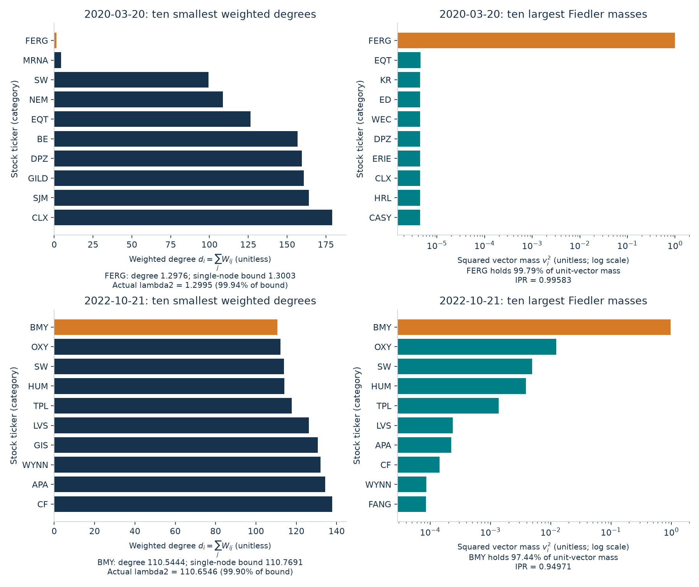
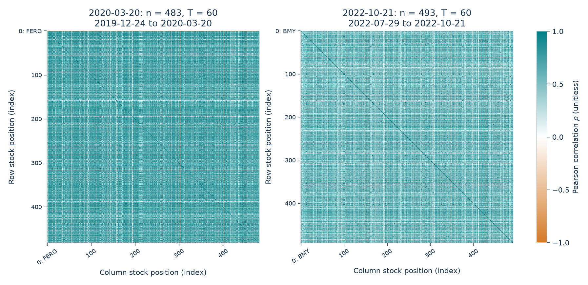
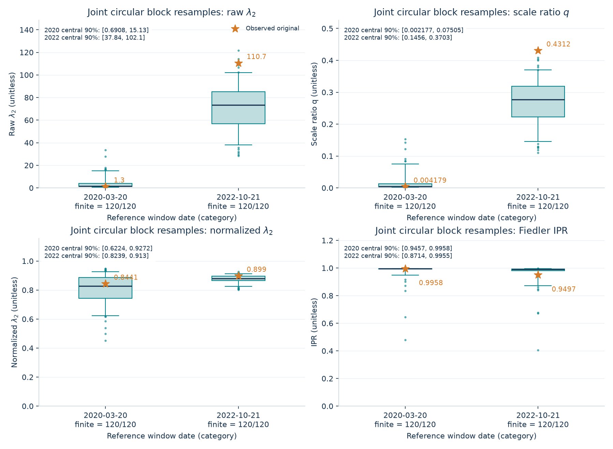

# Spectral Structure of Stock-Market Co-movement

**Part I — Descriptive study and interpretation of graph connectivity**

Mathew Tkachev · Working research paper · Updated October 15, 2026

## Abstract

This project asks whether relationships between assets can reveal useful market structure and eventually help estimate changing market risk. Part I studies a recovered daily stock-price panel using rolling Pearson correlations and a positive-weight graph Laplacian. The established calculation has been reproduced across 2,643 windows. Its second eigenvalue, called algebraic connectivity, closely tracks the smallest stock-level weighted degree: their descriptive correlation is 0.993548, and 84.449% of windows lie within 1% of a single-node upper bound. Fiedler eigenvectors are usually concentrated on one stock. These results explain an important limitation of the chosen measurement: a low value can coexist with strong average co-movement across the rest of the market. Price-history quality, changing sample composition and finite-window noise remain material limitations. No stock-market forecasting or calibrated future-risk result is established in this edition.

**In everyday language:** imagine stocks as dots joined by strings. Stronger positive co-movement makes a stronger string. The second eigenvalue asks how difficult it is to separate this network. Sometimes one loosely attached dot determines the answer, even when nearly all the other dots are tightly connected. We found this situation repeatedly. Understanding that behavior is a useful result before trying to make predictions.

## 1. Research question and current stage

The main question is: **what does spectral connectivity actually tell us about this stock-market sample?** A later question is whether a history of these measurements improves predictions of future dependence, volatility or diversification risk.

| Stage | Status in Part I |
|---|---|
| Recover the original stock panel and reproduce its rolling calculation | Completed; source bytes preserved locally. |
| Explain the second eigenvalue using degrees and eigenvectors | Completed descriptive analysis. |
| Compare selected graphs, scale adjustments and source-quality flags | Completed exploratory analysis. |
| Check exact toy examples and selected-window resampling | Completed exploratory controls. |
| Reconcile historical prices, corporate actions and stock membership | **Unfinished.** |
| Identify validated industry communities and their changes | **Not started in this stock study.** |
| Estimate future connectivity or market risk out of sample | **Not completed; no forecasting claim.** |

The active study is stocks only. Its daily graph uses a fixed methodological baseline; alternative windows, weighting rules and graph operators are future comparisons rather than silent changes to the existing results.

## 2. Data: what the sample contains

The source is the `Close` matrix originally downloaded through Yahoo Finance's public interface using a yfinance notebook. The live notebook matrix was recovered and frozen locally. Its daily labels are preserved.

| Item | Value |
|---|---:|
| Stock symbol columns | 503 |
| Daily price rows | 2,703 |
| Price-date range | January 4, 2016–October 2, 2026 |
| Observed price cells | 1,315,118 |
| Missing price cells | 44,491 of 1,359,609 possible cells |
| Observed coverage | 96.7277% |
| Return rows | 2,702 |
| Trailing-window length / step | 60 return observations / 1 observation |
| Window count and end dates | 2,643; March 31, 2016–October 2, 2026 |
| Stocks retained per window | 465–503; median 489 |

This is a panel of individual stock labels, not the S&P 500 index level and not a verified history of the index's constituents. The original universe scrape date, original retrieval time and exact `auto_adjust` setting were not recorded. Export-session package versions do not establish the versions used in the original download. Current yfinance documentation exposes explicit adjustment and repair parameters; its current defaults cannot recover these missing historical settings. See the [official download documentation](https://ranaroussi.github.io/yfinance/reference/api/yfinance.download.html).

The exact frozen `prices.csv.gz` SHA-256 is:

```text
8fc96b8b4b98d3e099a7506ab11b86b89aca042baa97ee2b37bfdf3cf38fde6b
```

The public repository retains [the dataset description](data/dataset.json), [window measurements](results/window_metrics.csv) and [numerical findings](results/findings.json). The raw provider-price snapshot and original notebooks remain local. The fingerprint identifies the particular saved bytes; it does not certify their economic accuracy. Downloading today's history would create a different snapshot requiring a separate comparison.

Why use this panel? It is the actual input behind the original calculation and spans many stocks and market environments. It lets us check what the original method measured. Why keep its limitations visible? Repeated prices, stock listings, splits, dividends and changes in membership can affect return correlations and graph structure.

### Figure 1 — What data reach each graph?



**How to read the axes:** the top and middle horizontal axes are the final date of each 60-return window. Their vertical axes count retained and removed stock columns, respectively. The dotted line marks all 503 input columns. The bottom horizontal axis is the source price date; its vertical axis is the percentage of the 503 closes observed on that date. Orange vertical markers indicate the two retrospectively selected windows discussed below.

**How it was made and what it shows:** count nonmissing prices by date, and separately count complete, nonconstant return columns in each window. These are different coverage measurements. The graph's stock count changes through time, so a change in connectivity may reflect composition as well as relationships.

## 3. The complete cleaning and calculation pathway

```text
Stock-market study
|-- 1. Preserve and understand the input
|   |-- Recover the daily stock Close matrix
|   |-- Keep source bytes and their fingerprint
|   `-- Validate dates, columns and observed prices
|-- 2. Prepare each historical sample
|   |-- Calculate arithmetic returns without filling gaps
|   |-- Take 60 returns ending on the displayed date
|   `-- Remove incomplete or nearly constant stocks in that window
|-- 3. Construct the relationship graph
|   |-- Estimate Pearson correlations on one common sample
|   |-- Keep positive weights and remove self-connections
|   `-- Build the weighted degrees and Laplacian
|-- 4. Measure and check its structure
|   |-- Calculate eigenvalues and the separated Fiedler vector
|   |-- Compare degrees, scale adjustments and localization
|   `-- Examine selected windows and exploratory controls
`-- 5. Interpret the evidence
    |-- Report findings, data-quality concerns and limitations
    `-- Future sector analysis and prediction: unfinished
```

The diagram is a workflow, so its position has no numerical axis. All calculations and scientific figures use Python.

1. **Validate the panel.** Require a chronological, unique daily index and unique stock columns. All observed closes in the recovered panel are finite and positive. Missing values are preserved. Validation does not resolve the original adjustment or membership questions.
2. **Calculate returns without filling.** For stock i on observation t, use the price ratio below. If either needed close is missing, the return is missing. The implementation uses `pct_change(fill_method=None)`.
3. **Use only the past at each endpoint.** A window contains 60 returns ending at its label date, requiring 61 consecutive observed closes for a retained stock. “60” means provider observation rows, usually trading sessions, rather than 60 calendar days.
4. **Clean separately inside each window.** Replace positive or negative infinity with missing values. Remove a stock if any return in that window is missing, or its sample standard deviation is at most 10⁻¹². A removed stock can reappear in another window. Do not forward-fill, interpolate, winsorize or delete flagged large returns in the established baseline.
5. **Use one common sample for all diagnostics.** Estimate every pairwise correlation from the same 60 rows and retained stock set. Do not mix pairwise-deletion samples.
6. **Build and diagnose the graph.** Record the node count, eigenvalues, connected components, degree statistics, mean correlations, scale comparisons and Fiedler localization. Preserve failures or unavailable diagnostics explicitly rather than inventing values.

Neighboring windows share 59 of their 60 returns. The 2,643 measurements therefore are not 2,643 independent experiments. The construction is trailing-only, but a historical universe chosen later can still introduce selection bias. A trailing calculation alone does not establish a bias-free forecasting test.

## 4. Mathematics and the meaning of each measurement

### 4.1 Returns and correlations

For observed closing price P:

$$
r_{t,i}=\frac{P_{t,i}}{P_{t-1,i}}-1.
$$

A return of 0.01 means a 1% increase between the two observations. We correlate returns rather than price levels to compare movements across different price scales.

For each cleaned window, subtract each stock's window mean and calculate Pearson correlation:

$$
C_{ij}=\frac{\sum_t(r_{t,i}-\bar r_i)(r_{t,j}-\bar r_j)}{\sqrt{\sum_t(r_{t,i}-\bar r_i)^2\sum_t(r_{t,j}-\bar r_j)^2}}.
$$

Correlation lies between −1 and 1. Positive means the sampled returns tend to move together; negative means they tend to move oppositely. It measures simultaneous linear association, not causation or a lead–lag mechanism.

### 4.2 Graph and Laplacian

Each retained stock is a node. Its positive correlation with another stock is the edge weight:

$$
W_{ij}=\max(C_{ij},0)\quad(i\ne j),\qquad W_{ii}=0,
$$

$$
d_i=\sum_jW_{ij},\qquad D=\mathrm{diag}(d_1,\ldots,d_n),\qquad L=D-W.
$$

The weighted degree d is the total positive connection weight of a stock. Self-connections are removed. Negative correlations are discarded in this baseline; this does not mean they are absent or economically irrelevant. A separate negative or signed graph has **not** been implemented in this edition.

L is symmetric and positive semidefinite because:

$$
x^\mathsf{T}Lx=\sum_{i\lt j}W_{ij}(x_i-x_j)^2\ge0.
$$

Its eigenpairs satisfy Lv = λv. In increasing order:

$$
0=\lambda_1\le\lambda_2\le\cdots\le\lambda_n.
$$

The number of zero eigenvalues equals the number of connected components. The second eigenvalue λ₂ is algebraic connectivity. Its variational description is:

$$
\lambda_2=\min_{x\perp\mathbf{1},\lVert x\rVert_2=1}x^\mathsf{T}Lx.
$$

It describes the least-cost continuous, zero-mean contrast across the weighted graph, which can concentrate on one weakly attached stock. Raw λ₂ changes with node count, edge scale and composition. It is dimensionless here, not a dollar loss, volatility, probability or automatic measure of market safety. The graph-theoretic background comes from [Fiedler's algebraic-connectivity paper](https://www.dml.cz/handle/10338.dmlcz/101168) and [Chung's spectral graph theory text](https://fanchung.ucsd.edu/research/outline.html).

### 4.3 Average dependence and two different scale comparisons

Using unordered off-diagonal pairs, including zero weights:

$$
\bar\rho=\frac{2}{n(n-1)}\sum_{i\lt j}C_{ij},\qquad
\bar w=\frac{2}{n(n-1)}\sum_{i\lt j}W_{ij}.
$$

The first averages raw correlations, including negatives. The second averages the positive-clipped graph weights. They answer different questions.

The **scale ratio** is:

$$
q=\frac{\lambda_2}{n\bar w}.
$$

For a complete graph with uniform weight c > 0, λ₂ = nc and q = 1. Multiplying every weight by the same positive constant leaves q unchanged. This removes uniform weight scale; it does not remove universe changes or estimation noise. If the denominator is zero, the diagnostic is unavailable.

The **degree-normalized Laplacian** is a different matrix:

$$
\mathcal L=I-D^{-1/2}WD^{-1/2}.
$$

When every degree is positive, this matrix is defined and its spectrum lies in [0,2]. Its second eigenvalue is stored as `normalized_lambda2`; it is not q. This implementation reports that diagnostic only for connected graphs with strictly positive degrees. It marks every disconnected graph unavailable, including disconnected graphs without isolated nodes, rather than silently choosing a reporting convention. Neither adjustment has been validated as a risk forecast.

### 4.4 A weak-node bound and the Fiedler vector

Let d_min be the smallest weighted degree. A vector assigning one node the value 1 and all other nodes −1/(n−1) is perpendicular to the all-ones vector. Its Rayleigh quotient gives:

$$
\lambda_2\le B=\frac{n}{n-1}d_{\min}.
$$

The ratio λ₂/B records proximity to this upper bound. Near equality suggests that a single-node contrast is close to the least-cost separation. It does not identify the economic cause or prove that the stock causes a market event.

The unit eigenvector associated with λ₂ is the **Fiedler vector**. Its sign is arbitrary. Squared entries v_i² show how its unit mass is distributed among stocks. We summarize concentration using the inverse participation ratio:

$$
\mathrm{IPR}=\sum_i v_i^4,\qquad \sum_i v_i^2=1.
$$

IPR lies between 1/n and 1. High values mean concentration on few coordinates; low values mean more spread. It is not an industry classification. We report vector interpretation only for a connected graph with λ₂ numerically separated from zero and λ₃. Numerical separation does not imply stability under different samples, and a repeated eigenvalue would not define a unique Fiedler direction.

## 5. Results from the stock panel

The full historical calculation matches all original notebook reference dates and retained-stock counts. Maximum absolute differences are approximately 1.99×10⁻¹³ for λ₂ and 2.22×10⁻¹⁶ for mean correlation. This verifies reproduction of the saved calculation, not the correctness of every provider quote. This compact edition reuses those frozen derived measurements and recomputes selected windows when requested; it does not present a fresh download as the original sample.

### Figure 2 — Connectivity and average co-movement through time



**Axes:** both horizontal axes are trailing-window end dates. The top vertical axis is raw λ₂, the dimensionless graph-connectivity measurement. The bottom vertical axis is mean pairwise correlation or mean clipped weight, also dimensionless; the two lines use the definitions in Section 4.3.

**Calculation and finding:** plot the saved per-window measurements without smoothing or future values. Raw λ₂ ranges from 1.299549 to 110.654597; its median is 15.101101. Its descriptive correlation with average raw correlation is 0.367177. The two series are related, but they do not describe the same property. Overlap between windows prevents interpreting this correlation as evidence from independent observations.

### Figure 3 — Scale adjustment changes the question



**Axes:** the horizontal axes are window end dates. The upper vertical axis is q = λ₂/(n mean positive weight). The lower vertical axis is the second eigenvalue of the degree-normalized Laplacian. Both are unitless but have different definitions. Dashed markers identify the selected extrema of raw λ₂.

**Calculation and finding:** compute each diagnostic on the same cleaned window. Their histories differ substantially. In particular, the March 2020 raw minimum does not become a minimum of the degree-normalized measure. Choosing a normalization changes the graph question; it does not establish which score predicts risk.

### Figure 4 — Much of the raw score follows the weakest stock



**Axes:** all horizontal axes are window end dates. The top vertical axis compares raw λ₂ with minimum weighted degree, both unitless sums of correlation-based weights. The middle vertical axis is λ₂/B; values close to 1 approach the single-node bound. The bottom vertical axis is Fiedler IPR; values near 1 indicate strong concentration. These are three different diagnostics, not probabilities.

**Calculation and finding:** calculate the bound and IPR for each graph. The correlation between λ₂ and minimum degree is **0.993548**. In **2,232 of 2,643 windows (84.449%)**, λ₂ is within 1% of the bound. Median λ₂/B is 0.997288. Median IPR is 0.991970, and **2,254 windows (85.282%)** exceed 0.9. All 2,643 saved graphs are connected and have a numerically separated Fiedler eigenvalue. This is strong descriptive evidence of frequent weak-node dominance in this particular graph construction and sample.

### Figure 5 — What do the minimum and maximum actually look like?



**Axes:** each vertical axis lists stock tickers as categories. Left horizontal axes show weighted degrees, the sum of each stock's positive connections. Right horizontal axes show squared Fiedler-vector mass on a **logarithmic** scale: equal horizontal steps mean multiplication by ten, not addition. Only the ten smallest degrees and ten largest masses are shown, ranked separately. The highlighted weak stock need not share rank order with every other stock across panels.

| Measurement | March 20, 2020: raw minimum | October 21, 2022: raw maximum |
|---|---:|---:|
| Retained stocks | 483 | 493 |
| Raw λ₂ | 1.299549 | 110.654597 |
| Average raw correlation | **0.641949** | **0.520498** |
| Minimum-degree stock | FERG | BMY |
| λ₂ / single-node bound | 99.9418% | 99.8967% |
| Weak stock's squared Fiedler mass | 99.7912% | 97.4431% |

**Interpretation:** the window with the lower raw connectivity has the **higher** average correlation. Calling the low score “low market dependence” would therefore be misleading here. The vector concentrates on one stock in each window. These windows were selected after examining the whole history; they are examples for diagnosis, not prospectively selected prediction tests.

FERG has **34 exactly zero returns out of 60** in the selected window. These are repeated observed closes, not zero prices and not values filled by this analysis. Its sample standard deviation remains about 0.038970, so it survives the baseline constant-column rule. The repeated history needs independent source, listing and corporate-action review. No verified economic explanation is assigned to it.

The full panel also contains 14 finite daily-return observations with absolute magnitude above 50%, including saved MRNA +176.97% and CTVA −83.81% observations. They are investigation flags, not verified errors or verified market events. The baseline keeps them. A low missing-value count alone does not make a price history clean enough for economic inference.

### Figure 6 — Relationships among all retained stocks



**Axes and color:** horizontal and vertical axes index the retained stocks in the displayed matrix order, with the weakest stock placed first. A cell compares its row stock with its column stock. The color bar is raw Pearson correlation from −1 to +1: orange is negative, white near zero and teal positive. The diagonal compares a stock with itself and equals 1. This is the raw C matrix, before positive clipping.

**Calculation and finding:** calculate correlations on each selected common 60-return sample. Pale rows or columns identify stocks behaving differently from much of the sample. These images show heterogeneous co-movement, but their displayed order is not a fitted industry clustering. The two panels have different retained stocks; a row number is not a stable cross-date stock identifier. Validated sector labels and comparison of persistent stock identities remain unfinished.

## 6. Interpretation controls and sensitivity

### 6.1 Removing the weak node is a sensitivity, not a repair

Recomputing the selected graph after removing its minimum-degree stock gives:

| Window / excluded stock | Original λ₂ | Reduced-graph λ₂ | Change in degree-normalized λ₂ |
|---|---:|---:|---:|
| March 2020 / FERG | 1.299549 | 4.431439 | +0.0083% |
| October 2022 / BMY | 110.654597 | 112.041381 | +0.0592% |

The first raw increase is about 241%, yet IPR remains near 0.996 after removing FERG. Another weak-node effect can remain. Removing a stock changes the graph, its node count and composition; these results do not replace the original baseline or prescribe an investment action.

### 6.2 Exact synthetic checks

Synthetic graphs help distinguish mathematical behavior from financial discovery. For a complete n-node graph with uniform edge weight c > 0, the nonzero Laplacian eigenvalues are all nc and q = 1. Thus uniformly stronger edges increase raw λ₂ without changing q.

For four nodes split into two equal groups, let within-group weight be a and between-group weight be b. The spectrum is 0, 4b, 2(a+b), 2(a+b); if a ≥ b ≥ 0, λ₂ = 4b. Two examples illustrate why an average does not describe every bottleneck:

| Synthetic graph | a | b | Mean weight | λ₂ | q |
|---|---:|---:|---:|---:|---:|
| A | 0.8 | 0.1 | 1/3 | 0.4 | 0.3 |
| B | 0.4 | 0.3 | 1/3 | 1.2 | 0.9 |

These are teaching controls, not stock observations. The public numerical checks test the underlying matrix identities.

### 6.3 Finite samples can create positive graph edges

An exploratory reference generated 80 independent Gaussian panels for each selected dimension: 60 observations with either 483 or 493 stocks. Each return was sampled independently from a mean-zero Gaussian with standard deviation 0.01; Pearson correlation and positive clipping were applied exactly as for the stock graph. Explicit seeds began from 20261008. All 160 calculations succeeded.

Median q was 0.723386 and 0.725164, respectively, compared with observed values 0.004179 and 0.431172. Even independent populations produce nonzero sample correlations, and positive clipping keeps positive fluctuations. This comparison demonstrates finite-sample behavior. It is not a realistic market model, a discovery p-value or a calibrated risk probability.

With 60 centered observations, the raw sample correlation matrix has rank at most 59 even though it contains hundreds of stocks. Positive clipping is nonlinear, so that rank bound must not be transferred to W or L. Estimation noise is a substantive issue.

### Figure 7 — Sensitivity to resampling the selected histories



**Axes and symbols:** horizontal axes are the two selected window dates as categories. Vertical axes show raw λ₂, q, degree-normalized λ₂ and Fiedler IPR in separate panels; all are unitless. Orange stars mark the original observed graphs. Box centers are medians, boxes cover the middle 50%, whiskers reach observations within the 5th–95th percentile bounds, and dots beyond them are additional resampled outcomes. Printed central 90% ranges use the sample quantiles.

**Method:** draw ten six-row blocks with replacement from each cleaned 60-row window, wrapping around its end when necessary. Apply the same row indices to every stock, preserving joint movements within each block. Concatenate to 60 rows and recompute the graph. Keep the original asset set fixed; failures or unavailable diagnostics must be recorded, not silently removed. There are 120 resamples per window, with explicit seeds from 20261008; all 240 computations succeeded.

**Finding:** the central 90% q ranges are [0.002177, 0.075049] for March 2020 and [0.145584, 0.370290] for October 2022. Several diagnostics vary substantially when the sampled rows change. These are exploratory resampling ranges, **not formal confidence intervals or probabilities of future outcomes**. Six-row blocks, retrospective endpoint selection and a single finite window limit the interpretation.

## 7. What this says about market structure and risk

The study establishes that this particular positive-correlation graph has measurable connectivity and repeated eigenvector localization. It gives a way to inspect which stocks determine the score and to check whether a graph measurement reflects a broad split or a weak individual node. Earlier research shows that correlation-based financial networks can reveal economic organization, but that does not establish industry structure in this specific sample. See [Mantegna's original financial-network study](https://arxiv.org/abs/cond-mat/9802256) and [Tumminello, Lillo and Mantegna on filtering and stability](https://arxiv.org/abs/0809.4615).

Portfolio variance provides a concrete reason relationships can matter:

$$
\mathrm{Var}(R_p)=w^\mathsf{T}\Sigma w,\qquad
\Sigma=\mathrm{diag}(\sigma)\cdot C\cdot\mathrm{diag}(\sigma).
$$

Here w is the portfolio's allocation vector and σ contains individual return volatilities. Holding these quantities fixed, a change in C can change portfolio variance. However, clipping negative correlations and reducing a graph to one eigenvalue discards information. Raw λ₂ by itself does not specify w, σ, tail losses, liquidity or economic exposures. We have not tested whether it adds useful future-risk information beyond simple correlations and volatility.

**Supported finding:** the chosen spectral measurement requires stock-level diagnostics before market-wide interpretation. **Unanswered question:** whether a better-controlled spectral representation provides additional information about future risk or the future direction of connectivity.

## 8. Limitations of this edition

- **Source provenance and quality:** adjustment, corporate-action treatment, exact original download time and historical universe membership are unresolved. Repeated closes and large returns need external reconciliation.
- **Changing stock sets:** 465–503 stocks enter different graphs. Raw scores cannot be treated as measurements on an unchanged network.
- **Short, overlapping samples:** 60 observations estimate many relationships; adjacent windows share 59 returns. Dependence and estimation noise limit inference.
- **Restricted relationships:** simultaneous linear correlations exclude nonlinear and lead–lag effects; positive clipping excludes opposite movements. No claim about physical links or causal contagion follows from this graph.
- **Retrospective choices:** the two extrema and exploratory control settings were chosen for diagnosis. They do not constitute a held-out forecast evaluation.
- **Limited economic labels:** a ticker is an identifier, not a verified historical industry classification. Sector findings and structural stability remain incomplete.
- **No predictive evaluation yet:** fitting a distribution to historical λ₂ values would describe past scores. It would not by itself estimate a reliable probability for the next 20 or 100 sessions.

## 9. Continuing the research — unfinished

### 9.1 Reconcile the stock panel and compare a fixed cohort

**Unfinished.** Review suspicious histories against independent corporate-action and listing records; distinguish legitimate jumps from source problems. Preserve the original baseline and label any corrected or adjusted panel as a separate version or snapshot. Compare it with a fixed, explicitly selected stock cohort so composition changes can be measured. Historical selection bias must remain visible.

### 9.2 Identify industry structure and stability

**Not started.** Add dated industry classifications, compare within-industry and between-industry relationships, and study whether multi-dimensional spectral partitions agree with economically meaningful groups. Compare partitions across resamples and dates with stable stock identifiers; do not rely on an eigenvector's arbitrary sign. Negative-relationship graphs and robust correlation estimators are candidates for separate, named experiments.

### 9.3 Test future connectivity and risk

**Not completed.** Define one target before optimizing settings: for example the future change in a fixed-universe connectivity measure, or future portfolio variance relative to a simple baseline. A history of K daily windows of length W spans W + K − 1 return observations; it does not contain K independent windows. Test window lengths and history lengths using chronological training and validation, then one untouched later evaluation period. Separate training labels from evaluation dates and account for overlapping future horizons.

Compare spectral features against persistence, average correlation and trailing volatility. For probabilities, examine held-out calibration and Brier or log loss, with uncertainty that respects time dependence. For a continuous target, compare errors with persistence and simple historical-average forecasts. A discrete window-length search is appropriate initially; taking a derivative of a noisy, integer-window score would not establish an optimal forecast. Report failure to improve these baselines as a credible negative result if that is what the evidence shows.

### 9.4 A later electricity-price study

**Proposed only; no electricity data or code are included here.** Start within one coherent market, such as a set of California locations with matching hourly locational marginal prices from [CAISO's historical OASIS archive](https://oasis-bulk.caiso.com/). Its [official price guide](https://www.caiso.com/todays-outlook/prices) explains energy, congestion and loss components. Nodes would be locations; one graph could describe price co-movement and another could represent documented transmission connections or congestion. Keep these graph meanings separate. Electricity can have zero or negative prices, so stock-style percentage returns may be unsuitable: compare price changes or another explicitly justified transformation. Resolve time zones, daylight-saving transitions, missing intervals and price components first.

Useful questions would include whether locations form persistent price groups and whether those groups separate during congestion. Transport losses, capacity, schedules and settlement constraints would be needed before making any claim about feasible physical arbitrage. This is an extension plan, not a finding of Part I.

Group, ring and field theory, topology and differential equations have not been applied in this edition. They should enter only when a precise mathematical object and testable question justify them.

## 10. Code, saved results and references

The repository keeps four Python files: [data handling](stock_data.py), [common graph mathematics](spectral_core.py), [analysis and figures](stock_analysis.py), and [numerical checks](checks.py). The figures are Python-generated assets embedded in this document; they are stored separately so GitHub can display them reliably. `results/window_metrics.csv` supplies the historical plots; `results/findings.json` records selected-window and exploratory-control summaries. All results in this paper are descriptive unless explicitly labeled as synthetic.

The 60-return baseline is established and retained for comparison. The choice of market representation, data quality and usefulness of its outputs remain research questions.

- Fiedler, M. (1973). [Algebraic connectivity of graphs](https://www.dml.cz/handle/10338.dmlcz/101168). *Czechoslovak Mathematical Journal*, 23(2), 298–305. Background for algebraic connectivity; the weighted bound used here follows directly from the displayed Rayleigh argument.
- Chung, F. R. K. (1997). [Spectral Graph Theory](https://fanchung.ucsd.edu/research/outline.html). AMS. Background for Laplacian spectra and degree normalization.
- Mantegna, R. N. [Hierarchical Structure in Financial Markets](https://arxiv.org/abs/cond-mat/9802256). Original financial correlation-network research; its tree construction and logarithmic returns differ from this project's baseline.
- Tumminello, M., Lillo, F. and Mantegna, R. N. [Correlation, hierarchies, and networks in financial markets](https://arxiv.org/abs/0809.4615). Background on filtering correlation structure and assessing stability.
- yfinance maintainers. [Official `download` API documentation](https://ranaroussi.github.io/yfinance/reference/api/yfinance.download.html). Current acquisition-parameter reference; not evidence of the original notebook's unrecorded settings.
