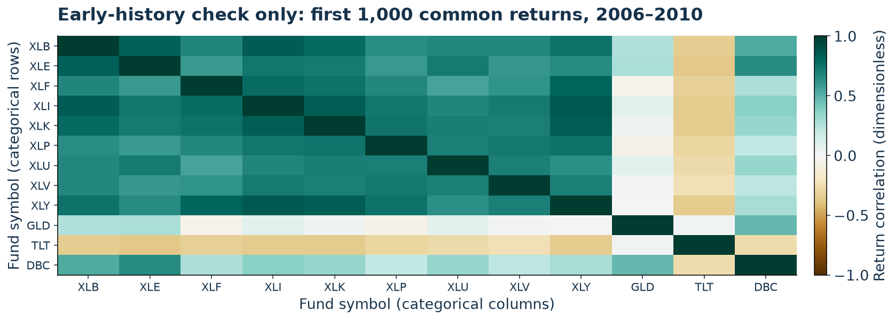
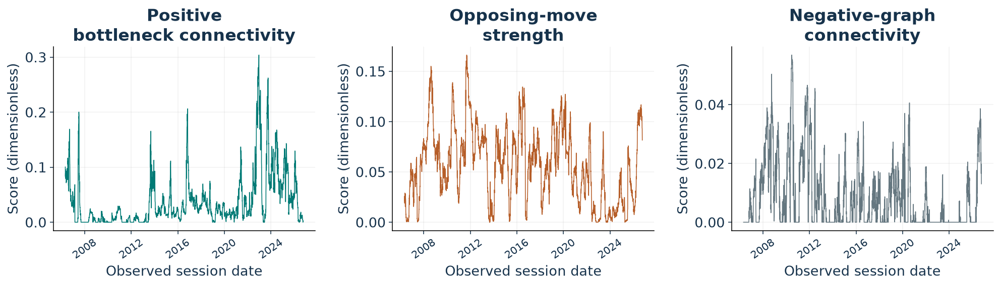
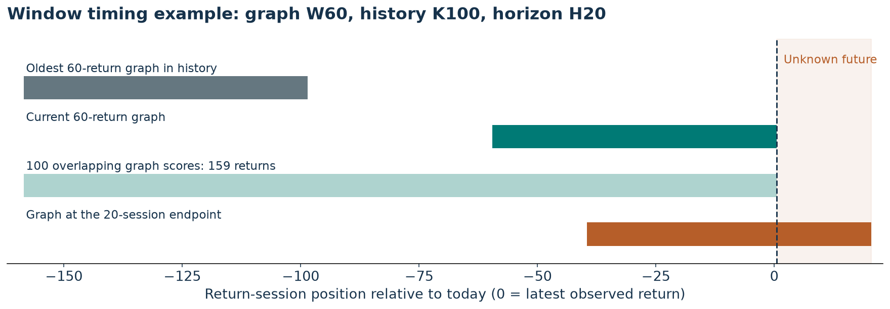
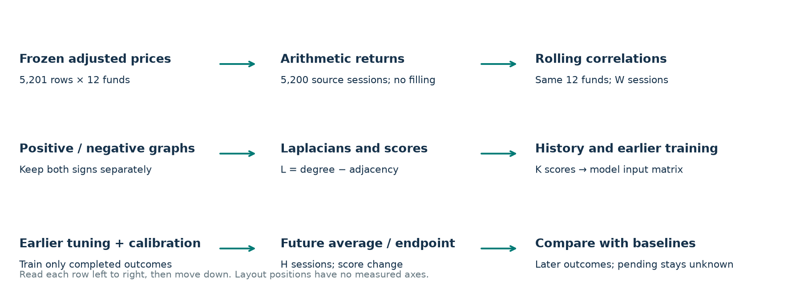
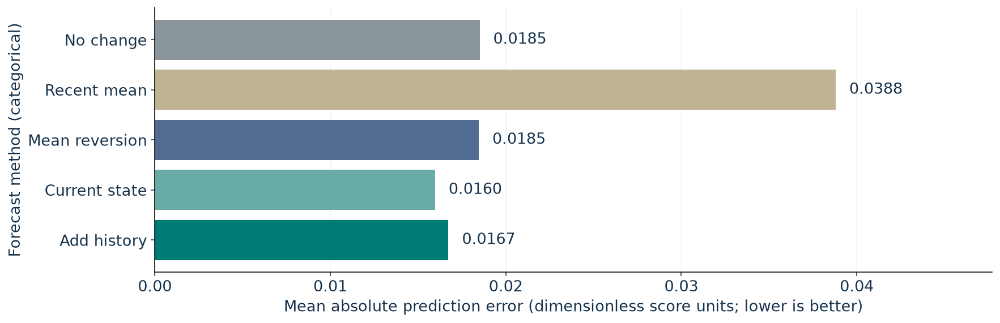
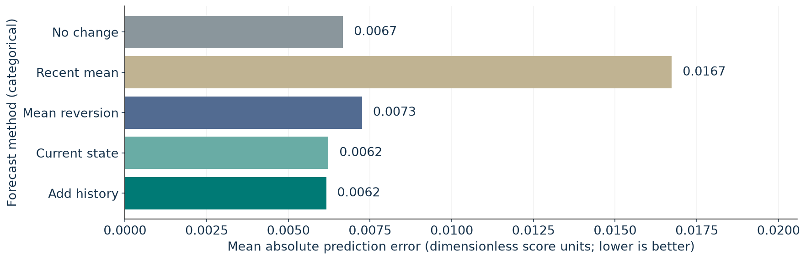
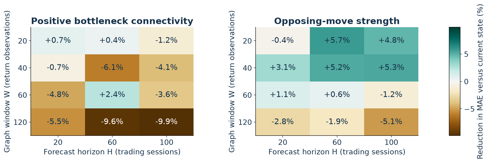
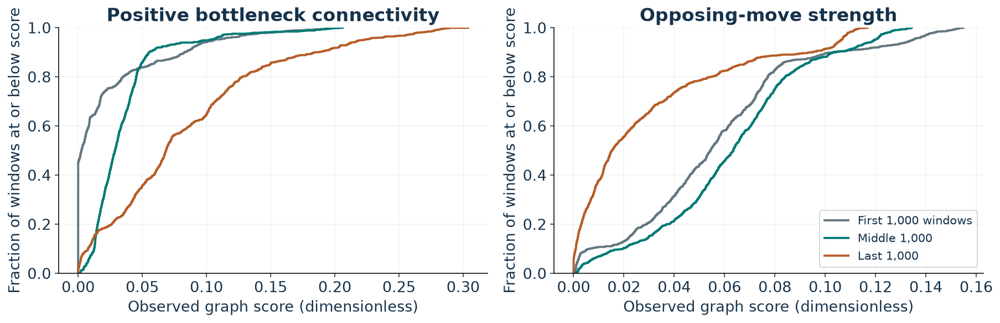
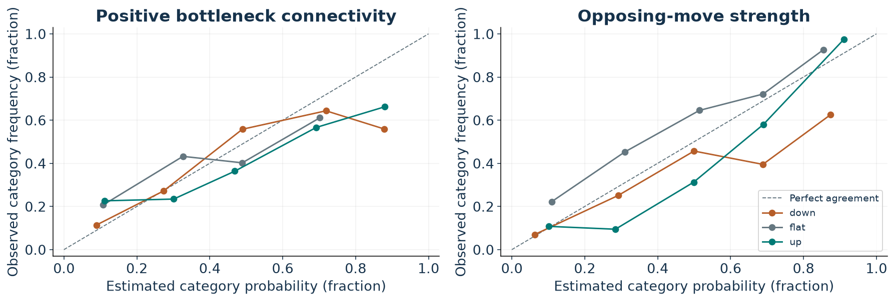
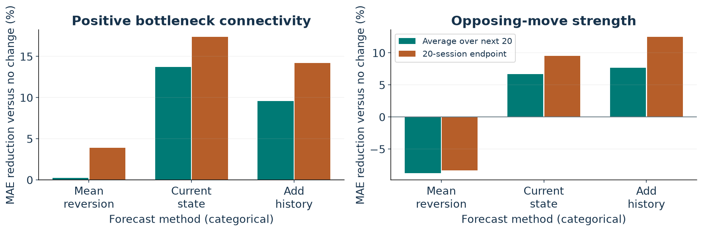

# Figure reading guide

Each figure is a Python-generated analytical derivative. No raw per-asset price feed is distributed. Network/workflow layout positions have no quantitative measurement unless an axis explicitly says otherwise.

## Different exposures produce different links

Rows/columns identify funds. Color is return correlation: green together, brown opposite. This early check does not prove predictability.

## The structure changes through time

x: observed session date. y: each dimensionless score, on its own scale. These describe relationships—not whether prices rose or fell.

## Three lengths answer different questions

x: return sessions relative to today. Rows show observation spans. W60 × K100 uses 159 returns; H20 adds 20 future sessions.

## The complete data-to-forecast pathway

Read rows left to right, then down. Positions are not measured axes. No prices or returns were filled.

## Positive connectivity: history is not the best model

x: average error; smaller is better. y: forecast method. Added history reduced error 9.6% versus no change; extra value beyond current state is uncertain.

## Opposing moves: a modest measured improvement

x: average error; smaller is better. y: forecast method. Added history reduced error 7.7% versus no change; extra value beyond current state is uncertain.

## More history does not help every setting

Rows: graph length W. Columns: horizon H. Color/number: error reduction versus current state. Positive helps; negative hurts. All cells are exploratory.

## A curve describes the past, not a guarantee

x: observed W60 score. y: fraction of windows at or below it. Shifting curves show changing distributions; jumps at zero mark disconnected graphs.

## Probability estimates still need caution

x: estimated chance. y: observed frequency. Closer to diagonal is better. Nominal 90% bands covered 83.2% positive / 89.0% opposing outcomes.

## Future average and endpoint are separate tests

x: forecast methods. y: error reduction versus no change. Green averages the next 20 scores; brown predicts only the final score.
